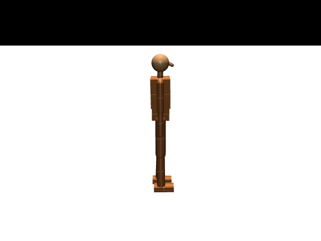

<div align="center">

# 🤖 X-Robot

**基于 MuJoCo + Stable-Baselines3 (PPO) 的人形机器人全身控制实验工程**

训练路线：稳定站立 → 直线行走 → 原地踏步，并附赠一套步态诊断、权重手术、零训练修复的分析工具链。




</div>

---

## 📋 目录

- [项目简介](#-项目简介)
- [环境准备](#-环境准备)
- [快速开始](#-快速开始)
- [训练](#-训练)
- [评估与诊断](#-评估与诊断)
- [分析工具](#-分析工具)
- [目录结构](#-目录结构)
- [常见问题](#-常见问题)
- [License](#-license)

---

## 🔍 项目简介

| 项目 | 说明 |
| --- | --- |
| 仿真模型 | `full_body.xml`（骨盆 + 双腿 + 腰 + 躯干 + 双臂 + 颈 + 头，**16 个执行器**） |
| 观测空间 | 45 维 |
| 动作空间 | 16 维，范围 `[-1, 1]` |
| 控制帧率 | `dt = 0.002 × 5 = 0.01 s` |
| 训练算法 | PPO（`MlpPolicy`，pi/vf 各 `[256, 256]`），观测/奖励均做 `VecNormalize` |

**核心特性**

- 🚶 三段式训练课程：站立 → 直线行走 → 原地踏步，任务间可互相热启动
- 💪 抗扰训练：随机外力推 + 课程式推力，训出抗推搡的稳健站立
- 🩺 完整诊断链：步态/步长诊断、训练曲线导出、多模型对比图
- 🔬 权重手术工具箱：零梯度修复拖步、CMA-ES 搜索、镜像等变分析、单元消融
- 🌐 支持网页实时可视化训练过程（可选模块）

---

## 🛠 环境准备

### 依赖版本（已在 macOS x86_64 + Python 3.12.4 验证）

| 包 | 版本 | 说明 |
| --- | --- | --- |
| python | 3.12.x | 工程 `.pyc` 历史为 3.10，用 3.12 亦可 |
| mujoco | **3.1.6** | ⚠️ 必须钉版本：3.2+ 不再提供 macOS x86_64 wheel，会转入源码编译并报 `MUJOCO_PATH environment variable is not set` |
| stable-baselines3 | 2.4.1 | |
| torch | 2.2.2 | macOS x86_64 上可用的较新版本 |
| gymnasium | 1.0.0 | |
| numpy | 1.26.4 | |
| tensorboard / matplotlib | latest | 训练曲线、诊断作图 |

### 一键准备（在工程根目录执行）

```bash
# 1) 创建虚拟环境并安装依赖（国内可用清华镜像）
python3.12 -m venv .venv
.venv/bin/python -m pip install -U pip -i https://pypi.tuna.tsinghua.edu.cn/simple
.venv/bin/python -m pip install -i https://pypi.tuna.tsinghua.edu.cn/simple \
    "mujoco==3.1.6" gymnasium stable-baselines3 torch tensorboard matplotlib

# 2) 包路径 shim：代码用 humanoid_rl.full_body.* 导入
mkdir -p .pythonpath/humanoid_rl
touch .pythonpath/humanoid_rl/__init__.py
ln -sfn ../.. .pythonpath/humanoid_rl/full_body

# 3) 验证
PYTHONPATH=$PWD/.pythonpath .venv/bin/python -c "
from humanoid_rl.full_body.walk_env import FullBodyWalkEnv
e = FullBodyWalkEnv(); print('obs', e.observation_space.shape, 'act', e.action_space.shape)
"
# 期望输出: obs (45,) act (16,)
```

> [!NOTE]
> `.pythonpath/humanoid_rl/full_body` 是指向工程根目录的相对软链，只影响 import，不改动任何源码。
> **所有训练/评估命令都必须在工程根目录执行**，这样 `checkpoints/`、`logs/` 才会落在工程内。

---

## 🚀 快速开始

先跑一个冒烟测试确认环境 OK：

```bash
PYTHONPATH=$PWD/.pythonpath .venv/bin/python -m humanoid_rl.full_body.train_walk \
    --steps 4096 --no-live --save-dir /tmp/xrobot_smoke --save-freq 0
```

看到 `ep_rew_mean`、`fps` 指标并打印「模型已保存」即环境就绪。

---

## 🏋️ 训练

统一形式（`--no-live` 表示关闭网页实时可视化）：

```bash
export PYTHONPATH=$PWD/.pythonpath
PY=.venv/bin/python
```

### 行走训练（从零，当前默认实验）

```bash
nohup $PY -m humanoid_rl.full_body.train_walk \
    --steps 5000000 --n-envs 8 --n-steps 2048 --batch-size 256 \
    --no-live --save-freq 100000 \
    > logs/train_walk_$(date +%Y%m%d).log 2>&1 &

tail -f logs/train_walk_$(date +%Y%m%d).log
```

- 无任何历史模型时直接从零训练；约 1000~1300 fps，5M 步大约 1~1.5 小时。
- 产物：`checkpoints/full_body_walk/walk.zip`、`walk_vecnorm.pkl`（每 10 万步覆盖保存）、`tb_logs/`。
- 硬盘友好：默认覆盖式保存；需要保留历史快照加 `--keep-snapshots`（写入 `checkpoints/full_body_walk/snapshots/`）。

### 站立训练

```bash
# 普通站立（从零）
$PY -m humanoid_rl.full_body.train_full_body --steps 1500000 --no-live --save-dir checkpoints/full_body

# 抗扰站立（随机外力推 + 更大 reset 随机化 + 课程式推力）
$PY -m humanoid_rl.full_body.train_full_body --steps 3000000 --no-live \
    --disturb --push-force 120 --push-interval 100 --reset-noise 0.05 \
    --push-curriculum --lr 1e-4 --save-dir checkpoints/full_body_robust
```

### 原地踏步训练（march）

```bash
$PY -m humanoid_rl.full_body.train_walk --task march \
    --steps 2000000 --n-envs 8 --no-live --save-dir checkpoints/full_body_walk
# 产物: checkpoints/full_body_walk/march.zip + march_vecnorm.pkl
```

> [!TIP]
> `march` 与 `walk` 观测维度相同，可互相热启动；`train_walk.py` 在切入 march 时会自动把
> timestep 计数清零，避免旧任务的 `ep_rew_mean` 误导判断。

### 续训 / 热启动（`--resume`）

`--resume` 只写**不含 `.zip`** 的路径，`<路径>_vecnorm.pkl` 会被自动配对加载，模型权重与观测归一化统计一起恢复：

```bash
# 接着当前行走模型继续训
$PY -m humanoid_rl.full_body.train_walk \
    --resume checkpoints/full_body_walk/walk --steps 3000000 --n-envs 8 --no-live

# 站立 → 行走进阶（同一套观测/动作，可整段加载）
$PY -m humanoid_rl.full_body.train_walk \
    --resume checkpoints/full_body/stand --target-speed 0.5 --speed-curriculum \
    --steps 3000000 --n-envs 8 --no-live
```

> [!TIP]
> `--lr` 默认 `1e-4`（`train_full_body` 默认 `3e-4`），调小可保护已学能力；
> `--save-dir` 指向新目录即可保留旧模型，不会被覆盖。

### 主要参数

**`train_walk.py`**

| 参数 | 默认 | 说明 |
| --- | --- | --- |
| `--task` | `walk` | `walk` 直线行走 / `march` 原地踏步 |
| `--steps` | 1,000,000 | 本次训练总步数 |
| `--save-dir` | `checkpoints/full_body_walk` | 模型与 `tb_logs` 目录 |
| `--resume` | 空 | 热启动模型路径（不含扩展名） |
| `--target-speed` | 0.5 | 目标前进速度 m/s（课程式时为上限） |
| `--speed-curriculum` | 关 | 目标速度 0.1 → `--target-speed` 线性递增 |
| `--lr` | 1e-4 | 学习率 |
| `--n-envs` | 1 | 并行环境数，>1 用 `SubprocVecEnv` |
| `--n-steps` | 2048 | 每环境每轮采样步数 |
| `--batch-size` | 256 | PPO minibatch |
| `--save-freq` | 100,000 | 覆盖式保存间隔（0 = 只在结束时保存） |
| `--keep-snapshots` | 关 | 额外保留带步数后缀的快照 |
| `--hip-sym-coef` / `--step-sym-coef` | 0 | 左右髋摆幅、步长对称惩罚系数 |
| `--imitate-delay` | 关 | 镜像模仿改用半周期延迟（修正旧版相位偏差） |
| `--no-live` / `--port` | 关 / 5000 | 网页实时可视化开关与端口 |
| `--seed` | 0 | 随机种子 |

**`train_full_body.py`**

| 参数 | 默认 | 说明 |
| --- | --- | --- |
| `--steps` | 1,500,000 | 总步数 |
| `--save-dir` | `checkpoints/full_body` | 输出目录 |
| `--resume` | 空 | 续训模型路径（不含扩展名） |
| `--disturb` | 关 | 启用抗扰训练（随机推力 + 大随机化） |
| `--push-force` / `--push-interval` | 120 N / 100 步 | 推力大小与间隔 |
| `--reset-noise` | 0.05 | reset 随机化幅度（抗扰建议 0.05） |
| `--push-curriculum` | 关 | 推力从 1/4 目标力线性增到 `--push-force` |
| `--lr` | 3e-4 | 抗扰续训建议 1e-4 |
| `--save-freq` | 100,000 | 覆盖保存间隔 |

### 停止与恢复

训练被 `kill` 后，最近一次定期保存的模型即可续训，不会丢进度：

```bash
pgrep -fl train_walk          # 查进程
kill <pid>                    # 停止（Ctrl+C 同理）
```

---

## 📊 评估与诊断

评估脚本会自动配对 `<model>_vecnorm.pkl`（`training=False`，不改统计）；`--model` 同样不带 `.zip`。

```bash
# 站立评估 / 导出 gif
$PY -m humanoid_rl.full_body.eval_stand --model checkpoints/full_body/stand --episodes 5
$PY -m humanoid_rl.full_body.eval_stand --model checkpoints/full_body/stand --gif stand_eval.gif

# 行走评估 / 导出 gif
$PY -m humanoid_rl.full_body.eval_walk --model checkpoints/full_body_walk/walk \
    --target-speed 0.5 --gif walk_eval.gif

# 抗扰对比（当前模型 vs baseline）
$PY -m humanoid_rl.full_body.eval_robust --model checkpoints/full_body_robust/stand \
    --baseline checkpoints/full_body/stand --push-force 150

# 训练曲线导出 png
$PY -m humanoid_rl.full_body.plot_metrics \
    --logdir checkpoints/full_body_walk/tb_logs --out checkpoints/full_body_walk/metrics.png

# 步态诊断：离地高度/拖行/抬脚频率/动作卡顿
$PY -m humanoid_rl.full_body.gait_diag --model checkpoints/full_body_walk/walk --episodes 3

# 步长诊断：着地步距/前伸/髋角
$PY -m humanoid_rl.full_body.step_diag --models checkpoints/full_body_walk/walk --episodes 5

# 多模型步态对比图
$PY -m humanoid_rl.full_body.plot_gait_cmp --out cmp.png \
    --models 原模型=checkpoints/full_body_walk/walk 手术模型=checkpoints/full_body_walk_surgery/walk_l05

# 参考步态物理可行性验证（需要显示器，或用 --no-viewer / --save-gif）
$PY -m humanoid_rl.full_body.play_ref_gait --freq 1.2 --hip-amp 0.35 --save-gif ref_gait.gif
```

---

## 🔬 分析工具

分析/手术类脚本（无需训练，只做前向闭环评估）：

| 脚本 | 作用 |
| --- | --- |
| `weight_surgery.py` | 用左腿控制回路镜像重写右腿输出层权重，零梯度修拖步（`--search` / `--sanity`） |
| `surgery_search.py` | 在镜像编辑空间用 CMA-ES 搜 λ/低秩修正（支持 `--workers` 并行） |
| `equivariance.py` | 策略镜像等变误差，量化手术会引入多大扰动（`--models` 必填） |
| `edit_locality.py` | 统计手术前后权重改动量与分布层 |
| `stand_walk_interp.py` | 站立↔行走权重插值/逐层替换，定位「开始走」的临界点 |
| `unit_analysis.py` | 隐藏单元功能定位 + 成组消融 |

---

## 📁 目录结构

```
X-Robot/                        # 工程根 = humanoid_rl/full_body 包
├── full_body.xml               # MuJoCo 模型
├── full_body_env.py            # 站立环境 FullBodyStandEnv
├── walk_env.py                 # 行走环境 FullBodyWalkEnv
├── march_env.py                # 原地踏步环境（继承 walk_env，复用 45 维观测）
├── train_full_body.py          # 站立训练入口
├── train_walk.py               # 行走 / 踏步训练入口
├── eval_*.py                   # 评估
├── *_diag.py / plot_*.py       # 诊断与作图
├── weight_surgery.py 等        # 零训练权重修复实验
├── .pythonpath/humanoid_rl/    # 仅为 import 服务的 shim
├── .venv/                      # 虚拟环境
├── logs/                       # 训练日志（nohup 重定向）
└── checkpoints/
    ├── full_body/              # stand.zip + stand_vecnorm.pkl
    └── full_body_walk/         # walk.zip / march.zip + *_vecnorm.pkl + tb_logs/
```

---

## ❓ 常见问题

<details>
<summary><b><code>RuntimeError: MUJOCO_PATH environment variable is not set</code>（安装 mujoco 失败）</b></summary>

最新版 mujoco 没有 macOS x86_64 轮子，退回源码编译。固定 `mujoco==3.1.6` 即可。

</details>

<details>
<summary><b><code>ModuleNotFoundError: No module named 'humanoid_rl'</code></b></summary>

没做包路径 shim。执行 [环境准备](#-环境准备) 的第 2 步，并确认命令带 `PYTHONPATH=$PWD/.pythonpath`、工作目录是工程根。

</details>

<details>
<summary><b><code>ModuleNotFoundError: humanoid_rl.full_body</code></b></summary>

shim 链接建错层级。正确结构是 `.pythonpath/humanoid_rl/full_body -> 工程根目录`（`full_body` 目录里直接就是 `walk_env.py` 等文件，不要再套一层）。

</details>

<details>
<summary><b><code>ModuleNotFoundError: humanoid_rl.visualization.live_server</code></b></summary>

网页实时可视化模块不在本仓库内。去掉 `--no-live` 会报这个错；补上 `visualization/live_server.py`（`LiveVisServer`，需提供 `start / push_frame / push_metrics / push_stage_change / stop`）后即可用 `http://localhost:5000` 观看。

</details>

<details>
<summary><b><code>n-envs > 1</code> 时网页画面不同步</b></summary>

多进程环境无法同步单个环境的物理状态，只推送指标曲线；需要看画面就用 `--n-envs 1`。

</details>

<details>
<summary><b>训练跑着跑着回合长度很短</b></summary>

从零训练初期 `ep_len_mean` 只有几十步属正常（跌倒或停滞 120 步即终止），看 `ep_rew_mean` 与 `ep_len_mean` 是否整体上行即可。

</details>

<details>
<summary><b>评估结果和训练时差很多</b></summary>

忘记加载 `_vecnorm.pkl`，或 `--target-speed` 与训练时不一致。评估脚本默认会在 `<model>_vecnorm.pkl` 存在时自动加载。

</details>

---

<div align="center">

## 📄 License

本项目采用 [**GNU AGPL-3.0**](LICENSE) 开源协议。

- ✅ 个人学习、科研、内部使用：**免费**
- ⚠️ 商业使用：允许，但基于本项目的**衍生产品（含网络服务）必须同样以 AGPL-3.0 开源**
- 💰 希望闭源商用？请联系作者获取**商业授权**：📧 huangyehui@gmail.com

</div>
